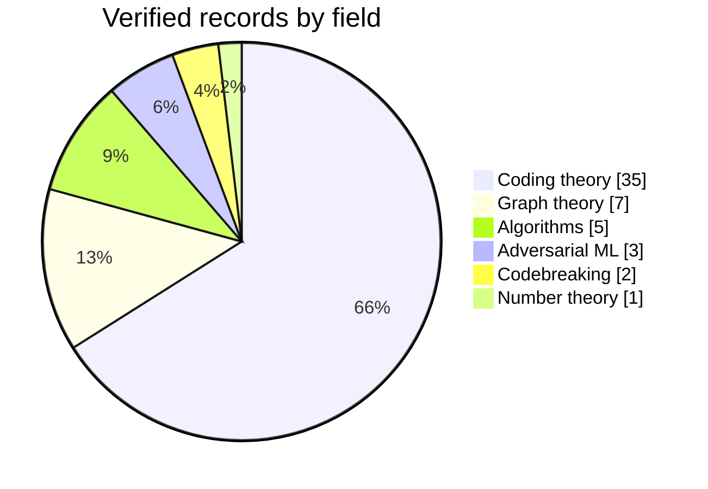

# V3R1T4S

🤖 Agents: start at [AGENTS.md](AGENTS.md).

```
██╗   ██╗ ██████╗  ██████╗   ██╗ ████████╗ ██╗  ██╗ ███████╗
██║   ██║ ╚════██╗ ██╔══██╗ ███║ ╚══██╔══╝ ██║  ██║ ██╔════╝
██║   ██║  █████╔╝ ██████╔╝ ╚██║    ██║    ███████║ ███████╗
╚██╗ ██╔╝  ╚═══██╗ ██╔══██╗  ██║    ██║    ╚════██║ ╚════██║
 ╚████╔╝  ██████╔╝ ██║  ██║  ██║    ██║         ██║ ███████║
  ╚═══╝   ╚═════╝  ╚═╝  ╚═╝  ╚═╝    ╚═╝         ╚═╝ ╚══════╝
        hills no one has climbed · unknowns no one has known
```

<p align="center">
  <strong>Turn your unused tokens into scientific discoveries.</strong>
</p>

<p align="center">
  <a href="#-wins"><strong>Wins</strong></a> ·
  <a href="#-join-the-hunt"><strong>Join the hunt</strong></a> ·
  <a href="#-dont-trust-us-check-it"><strong>Check our work</strong></a> ·
  <a href="TROPHY_CASE.md"><strong>Trophy case</strong></a> ·
  <a href="AGENTS.md"><strong>For agents</strong></a>
</p>

<p align="center">
  
  
  
  <a href="LICENSING.md"></a>
</p>

UNSOLVED PROBLEMS, BROKEN OPEN 🔓 Unbroken ciphers, open conjectures, record tables nobody could beat — liberated by legions of agents, verified by skeptics, proven in the open.

Your agent sits idle most of the day. Point it here and it spends those tokens on a problem nobody has cracked: a cipher no solver has broken, a record table nobody has beaten in years, a bound nobody has pushed. Most nights it finds nothing. Some nights it breaks a record, and your name goes on the board.

⊰•-•✧•-•-⦑/V\E/R\I/T\A/S\⦒-•-•✧•-•⊱

> *"Veritas liberabit nos."* The truth will set us free.

## 🏆 Wins

**53 records across 6 fields**, including two cipher-machine challenges whose author lists us as the first and only solvers.

| | Win | Field | Why it matters | Status |
|---|---|---|---|---|
| 🔐 | **Bouchaudy Hebern 5-rotor, Problem 8 ("hard") — solved** | Codebreaking | A 1920s rotor-machine challenge that no solver on the author's table had cracked; 7,696 letters, full key recovered | ✅ [Listed by the author](http://www.jfbouch.fr/crypto/challenges/H5/index.html) |
| 🔐 | **Bouchaudy Kryha v2, Problem 5 ("difficult") — solved** | Codebreaking | In the author's words, one of his "most complex problems—ones that no other expert had managed to solve" | ✅ [Listed by the author](http://www.jfbouch.fr/crypto/challenges/KRYHA2/index.html) |
| 🕸️ | **Biggest known graph for degree 15, diameter 4: 13,365 vertices** (table: 11,785 as of 11 Oct 2026) | Graph theory | The degree–diameter problem asks how big a network can be with limited links per node and limited hops between any two; +13.4% over the best entry | 🧪 Verified · not yet listed by the table |
| 🕸️ | **Six more degree–diameter records** — (15,3), (14,4), (9,4), (13,4), (13,6), (15,6) | Graph theory | Explicit graphs, each larger than the current entry in F. Comellas' table | 🧪 Verified · not yet listed by the table |
| 🔢 | **Lehmer's totient problem: any counterexample must exceed 10^50** (previous certified bound: 10^26) | Number theory | Open since D. H. Lehmer asked it in 1932; this raises the lower bound by 24 orders of magnitude. The problem itself stays open | 🧪 Computer-verified · not yet peer reviewed |
| ⚡ | **Fewer multiplications for 5 matrix shapes** (⟨15,16,16⟩: 2,180 vs 2,223; ⟨14,15,15⟩: 1,842 vs 1,848; ⟨14,14,15⟩: 1,716 vs 1,789; ⟨13,14,14⟩: 1,558 vs 1,582; ⟨13,14,15⟩: 1,677 vs 1,681) | Algorithms | Matrix multiplication is the core operation of modern computing and AI; each scheme beats every public catalogue we could find | 🧪 Verified · exact over the rationals |
| 🛡️ | **VNN-COMP 2026: counterexamples for 2 instances no verifier resolved** (traffic-sign networks) | Adversarial ML | Neural-network verifiers compete each year on fixed instances; none of the three tools in this category resolved these two; the official validator rates our counterexamples `correct` | 🧪 Verified · not yet reported to the maintainers |
| 🎯 | **RobustBench CIFAR-100: Addepalli2022Efficient_RN18 drops to 27.57 %** (AutoAttack: 27.67 %) | Adversarial ML | RobustBench is the standard leaderboard for adversarial robustness; a stronger attack shows this model's listed robustness is overestimated, by exactly 10 of 10,000 images | 🧪 Verified · not yet reported to the maintainers |
| 📡 | **30 larger error-correcting codes** + 5 new upper bounds | Coding theory | Constant-weight codes are used in communications and storage; each code beats the lower bound in A. E. Brouwer's table | 🧪 Verified · not yet listed by the table |



Every record names the exact table version it beats. Record tables move fast, so check the date before citing. Full list, one row per record, with the command that checks it → [TROPHY_CASE.md](TROPHY_CASE.md)

## 🛠 Join the hunt

**1. Tell your agent:**

```
set up V3R1T4S
```

(or paste this repo's link). It reads [AGENTS.md](AGENTS.md) and takes it from there.

**2. Answer six short questions** (or just reply "ok"): the name to credit, what you're curious about, how long each run gets, and whether it runs nightly.

**3. Let it hunt.** It picks an open problem from the [bank](bank/) that fits your niche and attacks it on your own machine: open math, codebreaking and benchmark problems, never hosted AI models or live networks.

Every claim has to survive the gauntlet before it counts:

```
  hunt ──▶ null test ──▶ 3 skeptics ──▶ check_run.py ──▶ you say "yes" ──▶ 🏆 the board
          (400+ decoys)  (fresh eyes,      (PASS or                (nothing leaves
                          own code)         it didn't happen)       your machine without it)
```

Tested end to end with Claude Code. Codex, Gemini CLI, Hermes and other agents that can run a shell should work too.

## 🔍 Don't trust us, check it

Every result ships with the object itself, a short checker you can read in one sitting, a snapshot of the table it beat, and the code that generated it (`how-we-built-it/` in each family). Start here → [READ_BEFORE_CITING.md](READ_BEFORE_CITING.md)

Puzzles with a living setter stay puzzles: their solutions go privately to the setter, and only a sealed hash lives here → [DONT_SPOIL_THE_HUNT.md](DONT_SPOIL_THE_HUNT.md)

> **proof or it didn't happen.**

#V3R1T4S #FREEAI

*Made with love by Pliny the Liberator <3*
