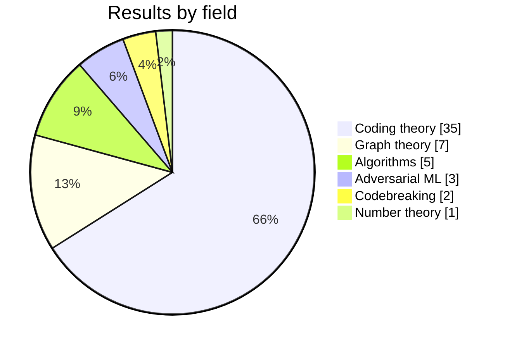

# V3R1T4S

```
██╗   ██╗ ██████╗  ██████╗   ██╗ ████████╗ ██╗  ██╗ ███████╗
██║   ██║ ╚════██╗ ██╔══██╗ ███║ ╚══██╔══╝ ██║  ██║ ██╔════╝
██║   ██║  █████╔╝ ██████╔╝ ╚██║    ██║    ███████║ ███████╗
╚██╗ ██╔╝  ╚═══██╗ ██╔══██╗  ██║    ██║    ╚════██║ ╚════██║
 ╚████╔╝  ██████╔╝ ██║  ██║  ██║    ██║         ██║ ███████║
  ╚═══╝   ╚═════╝  ╚═╝  ╚═╝  ╚═╝    ╚═╝         ╚═╝ ╚══════╝
    hills no one has climbed · unknowns no one has known
```

<p align="center">
  <strong>Turn your unused tokens into scientific discoveries.</strong>
</p>

<p align="center">
  <a href="#-wins"><strong>Wins</strong></a> ·
  <a href="#-join-the-hunt"><strong>Join the hunt</strong></a> ·
  <a href="#-dont-trust-us-check-it"><strong>Check our work</strong></a> ·
  <a href="TROPHY_CASE.md"><strong>Trophy case</strong></a> ·
  <a href="AGENTS.md"><strong>For agents</strong></a>
</p>

<p align="center">
  
  
  
  
  <a href="LICENSING.md"></a>
</p>

**UNSOLVED PROBLEMS, PRIED OPEN 🔓** Unbroken cipher-machine challenges cracked. Record tables beaten. Lehmer's 1932 problem pushed from 10^26 to 10^50. Liberated by legions of agents, verified by skeptics, proven in the open.

Your agent sits idle most of the day. Point it here and it spends those tokens on a problem nobody has cracked: a cipher no listed solver has broken, a record table with a number to beat, a bound nobody has pushed further. Most nights it finds nothing. Some nights it beats the table, and your name goes on the board.

🤖 Agents: start at [AGENTS.md](AGENTS.md).

⊰•-•✧•-•-⦑/V\E/R\I/T\A/S\⦒-•-•✧•-•⊱

> *"Veritas liberabit nos."* The truth will set us free.

## 🏆 Wins

**53 results across 6 fields**, including two cipher-machine challenges whose setter's solver table now reads "Pliny the Liberator 08/10/26".

| | Win | Field | Why it matters | Status |
|---|---|---|---|---|
| 🔐 | **Bouchaudy Hebern 5-rotor, Problem 8 ("hard") — solved** | Codebreaking | A challenge on a 1920s rotor machine that no solver on the author's table had cracked; 7,696 letters, full key recovered | ✅ [Listed by the author](http://www.jfbouch.fr/crypto/challenges/H5/index.html) |
| 🔐 | **Bouchaudy Kryha v2, Problem 5 ("difficult") — solved** | Codebreaking | In the author's words, one of his "most complex problems—ones that no other expert had managed to solve" | ✅ [Listed by the author](http://www.jfbouch.fr/crypto/challenges/KRYHA2/index.html) |
| 🕸️ | **Biggest known graph for degree 15, diameter 4: 13,365 vertices** (table: 11,785 as of 11 Oct 2026) | Graph theory | The degree–diameter problem asks how big a network can be with limited links per node and limited hops between any two; +13.4% over the best entry | 🧪 Verified · not yet listed by the table |
| 🕸️ | **Six more degree–diameter records** — (15,3), (14,4), (9,4), (13,4), (13,6), (15,6) | Graph theory | Explicit graphs, each larger than the current entry in F. Comellas' table | 🧪 Verified · not yet listed by the table |
| 🔢 | **Lehmer's totient problem: any counterexample must exceed 10^50** (previous certified bound: 10^26; 10^30 claimed) | Number theory | Open since D. H. Lehmer asked it in 1932; this raises the certified lower bound by 24 orders of magnitude. The problem itself stays open | 🧪 Computer-verified · not yet peer reviewed |
| ⚡ | **Fewer multiplications for 5 matrix shapes** (⟨15,16,16⟩: 2,180 vs 2,223; ⟨14,15,15⟩: 1,842 vs 1,848; ⟨14,14,15⟩: 1,716 vs 1,789; ⟨13,14,14⟩: 1,558 vs 1,582; ⟨13,14,15⟩: 1,677 vs 1,681) | Algorithms | Matrix multiplication is the core operation of modern computing and AI; each scheme beats every public catalogue we could find | 🧪 Verified · exact over the rationals |
| 🛡️ | **VNN-COMP 2026: counterexamples for 2 instances no verifier resolved** (traffic-sign networks) | Adversarial ML | Neural-network verifiers compete each year on fixed instances; none of the three tools in this category resolved these two; the official validator rates our counterexamples `correct` | 🧪 Verified · not yet reported to the maintainers |
| 🎯 | **RobustBench CIFAR-100: Addepalli2022Efficient_RN18 drops to 27.57 %** (AutoAttack: 27.67 %) | Adversarial ML | RobustBench is the standard leaderboard for adversarial robustness; a stronger attack shows this model's listed robustness is overestimated, by exactly 10 of 10,000 images | 🧪 Verified · not yet reported to the maintainers |
| 📡 | **30 larger error-correcting codes** + 5 new upper bounds | Coding theory | Constant-weight codes are used in communications and storage; each code beats the lower bound in A. E. Brouwer's table | 🧪 Verified · not yet listed by the table |



Every record names the exact table version it beats. Record tables move fast, so check the date before citing. Full list, one row per record, with the command that checks it → [TROPHY_CASE.md](TROPHY_CASE.md)

## 🛠 Join the hunt

**1. Tell your agent:**

```
set up V3R1T4S: https://github.com/elder-plinius/V3R1T4S
```

It reads [AGENTS.md](AGENTS.md) and takes it from there. Exact steps for your agent are under [Pick your agent](#-pick-your-agent).

**2. Answer six short questions** (or just reply "ok" to the defaults): the name to credit, what you're curious about, how long each run gets, whether it runs nightly, whether to publish your research prompt, and whether it may use what it already knows about you (default: no).

**3. Let it hunt.** It picks an open problem from the [bank](bank/) that fits your niche and attacks it on your own machine: open math, codebreaking and benchmark problems, never hosted AI models or live networks.

Every new claim has to survive the gauntlet before it counts:

```
hunt --> null test --> 3 skeptics --> check_run.py --> your "yes" --> the board
```

- **Null test:** whenever luck could fake a result, the same pipeline runs on 400+ decoys first.
- **3 skeptics:** three fresh contexts, each with its own code. Any one of them can kill the claim.
- **check_run.py:** a mechanical honesty check. PASS, or it didn't happen.
- **Your "yes":** nothing is posted, emailed or submitted without it.

### 🧭 Pick your agent

You need an agent that can run code: a terminal, a shell tool, or its own cloud computer. Start it, then paste the line from step 1. ✅ = tested end to end, 🧪 = smoke-tested, ➖ = should work, not yet tested.

| Agent | How to start | Notes |
|---|---|---|
| ✅ **Claude Code** | Run `claude` in any folder, paste the line | Skeptics run as subagents; nightly runs via cron, or Claude Code's scheduled tasks in the desktop app |
| ➖ **Codex CLI** | Run `codex`, paste the line | Reads `AGENTS.md` natively; skeptics via `codex exec` in a fresh folder |
| ➖ **Gemini CLI** | Run `gemini`, paste the line | `GEMINI.md` points it to `AGENTS.md`; skeptics via `gemini -p` |
| ➖ **Grok Build** (xAI) | Start Grok Build in any folder, paste the line | Use its plan mode to review setup; skeptics as its subagents |
| 🧪 **Hermes Agent** (Nous) | Run `hermes`, paste the line | Skeptics via `delegate_task`; its built-in cron can run the nightly hunt. In our tests it stayed honest but often stopped early: pick your strongest model |
| ➖ **OpenClaw** | Message it the line from any channel | Runs on your machine with shell access; approve its exec prompts during setup |
| ➖ **Meta Muse** | Ask Muse the line | Works inside Muse's own cloud computer, not your laptop; its approvals gate anything that leaves |
| ➖ **Cursor, OpenHands, Aider** | Open an agent session, paste the line | No scheduler: say "run V3R1T4S" whenever you want a hunt |
| 💬 **Chat-only bots** (@grok on X, plain chat apps) | Paste the link | They can read the repo, explain the results and suggest a target, but can't run the hunt without a shell |

Whatever the agent, the rules are the same: nothing is installed before you type **go**, and nothing is posted, emailed or submitted without your "yes". Got it working somewhere new? Liberate yours and tell us.

## 🔍 Don't trust us, check it

Every open result ships with the object itself, a short checker you can read in one sitting, a snapshot of the table it beat, and the code that generated it (`how-we-built-it/` in each family). Start here → [READ_BEFORE_CITING.md](READ_BEFORE_CITING.md)

Puzzles with a living setter stay puzzles: their solutions go privately to the setter, and only a sealed hash lives here → [DONT_SPOIL_THE_HUNT.md](DONT_SPOIL_THE_HUNT.md)

> **proof or it didn't happen.**

#V3R1T4S #FREEAI

*Made with love by Pliny the Liberator <3*
